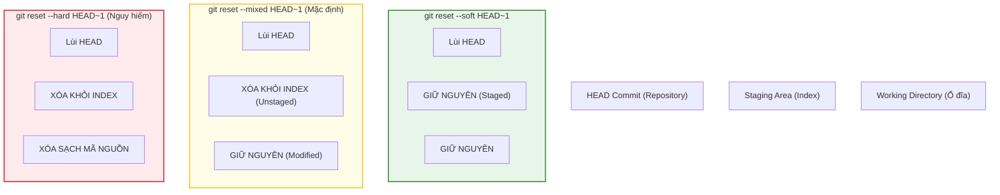
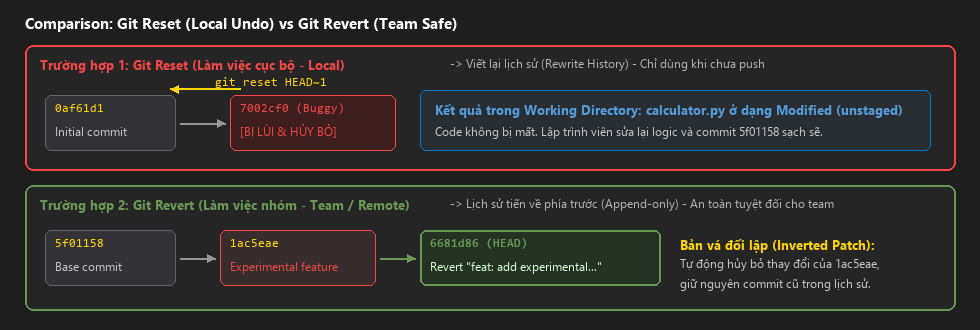
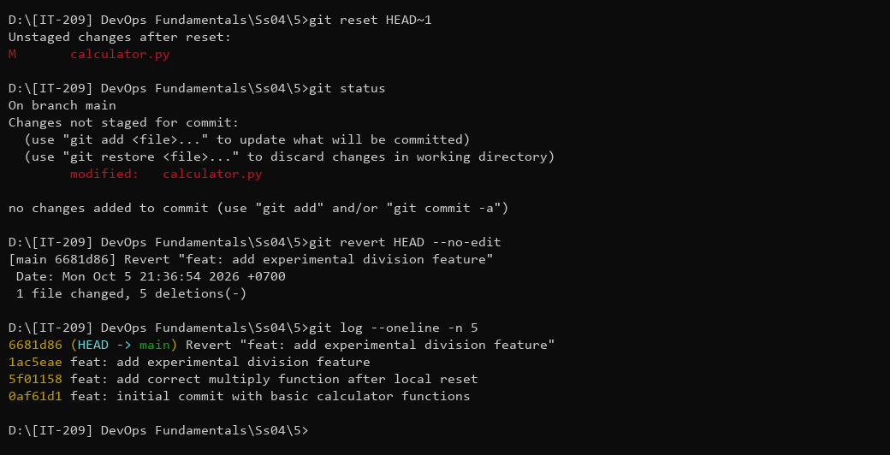

# Báo Cáo Bài Tập 5: Khôi Phục Trạng Thái Và Đảo Ngược Commit (Reset vs Revert)

- **Môn học**: DevOps Fundamentals (IT-209)
- **Session**: 04 - Git Version Control
- **Bài tập**: Bài 5 - Khôi phục trạng thái và Đảo ngược commit (Reset vs Revert)
- **Đường dẫn nộp bài trên GitHub**: `homework/session_04/ex5/`
- **Học viên**: HoQuocKhai
- **Email**: khaiho6040@gmail.com

---

## 1. Mục tiêu bài thực hành
1. **Làm chủ hai cơ chế khôi phục trạng thái Git**: Nắm vững nguyên lý và thao tác thực tế với `git reset` (thay đổi lịch sử cục bộ) và `git revert` (tạo commit đảo ngược an toàn).
2. **Xử lý tình huống sửa lỗi cục bộ (Trường hợp 1)**: Lùi con trỏ HEAD về 1 commit mà không làm mất mã nguồn hiện hành (không dùng `--hard`), giữ lại các thay đổi trong Working Directory để hoàn thiện lại code.
3. **Xử lý tình huống sửa lỗi công cộng (Trường hợp 2)**: Khắc phục lỗi của commit đã chia sẻ mà không viết lại lịch sử (không rewrite history), ghi nhận rõ ràng commit đối lập mang tiền tố `Revert ...`.
4. **Phân biệt ranh giới bảo mật & cộng tác nhóm**: Hiểu rõ khi nào nên dùng reset (chỉ dùng ở local chưa push) và khi nào bắt buộc phải dùng revert (khi commit đã push lên remote / nhánh chung).

---

## 2. So sánh chuyên sâu giữa `git reset` và `git revert`

### 2.1. Bảng so sánh tổng quan
| Tiêu chí | `git reset` | `git revert` |
| :--- | :--- | :--- |
| **Bản chất hoạt động** | Di chuyển con trỏ `HEAD` và nhánh lùi về quá khứ (viết lại lịch sử) | Tạo ra một **commit mới** mang nội dung đối lập để hủy bỏ thay đổi của commit cũ |
| **Lịch sử Git (History)** | Lịch sử bị thay đổi / rút ngắn, các commit sau đó bị loại bỏ khỏi nhánh | Lịch sử luôn tiến về phía trước (Append-only), lưu giữ minh bạch mọi vết tích |
| **Phạm vi áp dụng** | **Chỉ dùng ở Local** cho các commit chưa push lên remote | **Dùng cho Remote / Nhánh chung** (hoặc bất kỳ commit nào đã chia sẻ) |
| **Ảnh hưởng đến nhóm** | **Nguy hiểm**: Gây xung đột nghiêm trọng (diverged history) cho đồng nghiệp nếu đã push | **Tuyệt đối an toàn**: Đồng nghiệp chỉ cần `git pull` bình thường, không gây xung đột |
| **Rủi ro mất mã nguồn** | Cao (nếu dùng cờ `--hard`) | Không có rủi ro mất mã nguồn |

---

### 2.2. Phân tích 3 chế độ của `git reset`
Khi thực hiện `git reset <commit>`, Git hỗ trợ 3 cờ quan trọng điều khiển trạng thái 3 vùng làm việc:



1. **`git reset --soft HEAD~1`**: Chỉ di chuyển con trỏ HEAD lùi lại. Toàn bộ thay đổi của commit bị lùi vẫn nằm nguyên trong **Staging Area** (sẵn sàng để commit lại ngay).
2. **`git reset --mixed HEAD~1` (Mặc định)**: Di chuyển con trỏ HEAD lùi lại, đưa các thay đổi ra khỏi Staging Area về lại **Working Directory** dưới dạng `Modified` (unstaged). Đây là lựa chọn lý tưởng khi muốn chỉnh sửa lại logic code trước khi đóng gói lại.
3. **`git reset --hard HEAD~1`**: Di chuyển con trỏ HEAD lùi lại đồng thời **xóa sạch toàn bộ thay đổi ở cả Staging Area và Working Directory**. Không thể khôi phục mã nguồn chưa commit (rất nguy hiểm, bị cấm trong bài này).

---

## 3. Quá trình thực hiện chi tiết

### Khởi tạo dự án ban đầu
Khởi tạo kho chứa trên nhánh `main` và cấu hình tác giả:
```bash
git init -b main
git config --local user.name "HoQuocKhai"
git config --local user.email "khaiho6040@gmail.com"
```

Tạo tệp mã nguồn `calculator.py` và tạo commit đầu tiên:
```python
def add(a, b):
    return a + b

def subtract(a, b):
    return a - b
```

```bash
git add calculator.py
git commit -m "feat: initial commit with basic calculator functions"
```
**Kết quả commit:** `0af61d1`

---

### TRƯỜNG HỢP 1: Sửa đổi cục bộ (Local Undo via Reset)

#### Bước 1.1: Tạo commit chứa mã nguồn bị lỗi ở local
Học viên phát triển thêm tính năng phép nhân `multiply`, nhưng vô tình viết sai dấu tính toán thành dấu cộng:
```python
def multiply(a, b):
    # BUG: Phep nhan bi viet sai logic thanh phep cong
    return a + b
```

Tiến hành commit mã nguồn lỗi này:
```bash
git commit -am "feat: add multiply function (buggy logic)"
```
**Kết quả thực tế:**
```text
[main 7002cf0] feat: add multiply function (buggy logic)
 1 file changed, 5 insertions(+)
```

#### Bước 1.2: Sử dụng `git reset` an toàn (không dùng `--hard`)
Phát hiện lỗi logic khi commit này chưa được đẩy lên remote. Để giữ lại code và viết lại, học viên thực thi lệnh reset lùi lại 1 commit:
```bash
git reset HEAD~1
```
**Kết quả thực tế:**
```text
Unstaged changes after reset:
M	calculator.py
```

Kiểm tra trạng thái kho chứa bằng `git status`:
```bash
git status
```
**Kết quả thực tế:**
```text
On branch main
Changes not staged for commit:
  (use "git add <file>..." to update what will be committed)
  (use "git restore <file>..." to discard changes in working directory)
	modified:   calculator.py

no changes added to commit (use "git add" and/or "git commit -a")
```
*Phân tích*: Con trỏ HEAD đã lùi về commit trước đó (`0af61d1`). Toàn bộ thay đổi của hàm `multiply` vẫn được giữ nguyên vẹn 100% trong Working Directory dưới dạng `modified: calculator.py`, thỏa mãn hoàn hảo ràng buộc không làm mất code của đề bài.

#### Bước 1.3: Sửa lại mã nguồn chuẩn xác và commit lại
Sửa lại phép toán đúng logic trong `calculator.py`:
```python
def multiply(a, b):
    # Da sua dung phep nhan logic
    return a * b
```

Đưa vào Staging và tạo commit sạch:
```bash
git add calculator.py
git commit -m "feat: add correct multiply function after local reset"
```
**Kết quả thực tế:**
```text
[main 5f01158] feat: add correct multiply function after local reset
 1 file changed, 5 insertions(+)
```

---

### TRƯỜNG HỢP 2: Sửa đổi công cộng (Public Undo via Revert)

#### Bước 2.1: Tạo commit tính năng công cộng gặp lỗi
Tiếp tục bổ sung tính năng phép chia thử nghiệm `divide`:
```python
def divide(a, b):
    # Experimental feature: Phep chia chua co xu ly ngoai le ZeroDivisionError
    return a / b
```

Đóng gói commit:
```bash
git commit -am "feat: add experimental division feature"
```
**Kết quả thực tế:**
```text
[main 1ac5eae] feat: add experimental division feature
 1 file changed, 5 insertions(+)
```
*Bối cảnh*: Giả định commit `1ac5eae` này đã được đẩy lên nhánh chính của dự án và đồng nghiệp đã kéo về máy. Khi phát hiện tính năng gây lỗi hệ thống, **tuyệt đối không được dùng git reset** (vì sẽ phá hủy nhánh của đồng nghiệp).

#### Bước 2.2: Đảo ngược an toàn bằng `git revert`
Thực thi lệnh revert đối với commit gần nhất:
```bash
git revert HEAD --no-edit
```
**Kết quả thực tế:**
```text
[main 6681d86] Revert "feat: add experimental division feature"
 Date: Mon Oct 5 21:36:54 2026 +0700
 1 file changed, 5 deletions(-)
```

*Phân tích*:
- Git tự động sinh một commit mới mang mã hash `6681d86`.
- Tiêu đề commit bắt đầu bằng `Revert "feat: add experimental division feature"`.
- Nội dung của commit này là một bản vá ngược (inverted patch) xóa bỏ các dòng code lỗi của hàm `divide`.
- Lịch sử commit trước đó (`1ac5eae`) vẫn được lưu lại trọn vẹn, giúp việc truy vết lỗi (audit trail) minh bạch và an toàn khi làm việc nhóm.

---

## 4. Kết quả kiểm tra theo yêu cầu đề bài

### 4.1. Xem lịch sử commit (`git log --oneline -n 5`)
```bash
git log --oneline -n 5
```
**Kết quả thực tế:**
```text
6681d86 (HEAD -> main) Revert "feat: add experimental division feature"
1ac5eae feat: add experimental division feature
5f01158 feat: add correct multiply function after local reset
0af61d1 feat: initial commit with basic calculator functions
```

*Đánh giá đối chiếu kết quả mong đợi*:
1. **Trường hợp 1**: Con trỏ HEAD đã lùi lại thành công trong quá trình reset, sau đó commit mới `5f01158` thay thế hoàn toàn commit lỗi `7002cf0` mà không để lại vết lỗi cục bộ.
2. **Trường hợp 2**: Commit mới `6681d86` mang tiêu đề bắt đầu bằng `Revert ...` xuất hiện trên đầu nhánh, đảo ngược thành công commit `1ac5eae`.

---

### 4.2. Kiểm tra chi tiết commit Revert gần nhất (`git log -n 1`)
```bash
git log -n 1
```
**Kết quả thực tế:**
```text
commit 6681d863f6ee526b72a6bca380e2f5f14e21a2eb (HEAD -> main)
Author: HoQuocKhai <khaiho6040@gmail.com>
Date:   Mon Oct 5 21:36:54 2026 +0700

    Revert "feat: add experimental division feature"
    
    This reverts commit 1ac5eae1fa5eeadbb65179ee4fc3b9265f21223e.
```

---

### 4.3. Kiểm tra trạng thái kho chứa sau cùng (`git status`)
```bash
git status
```
**Kết quả thực tế:**
```text
On branch main
nothing to commit, working tree clean
```

---

## 5. Ảnh chụp màn hình minh chứng

### Minh chứng 1: Sơ đồ trực quan hóa sự khác biệt giữa Reset và Revert


### Minh chứng 2: Chạy các lệnh kiểm tra và lịch sử commit revert trên Terminal


---

## 6. Bài học kinh nghiệm trong làm việc nhóm (Team Collaboration Rules)
1. **Quy tắc vàng của Git**:
   - **Chưa Push -> Tự do dùng Reset**: Nếu commit mới tạo ở máy cục bộ và chưa bao giờ push lên máy chủ, lập trình viên có thể dùng `git reset` hoặc `git commit --amend` để giữ lịch sử cá nhân gọn gàng.
   - **Đã Push -> Bắt buộc dùng Revert**: Một khi commit đã hiện diện trên GitHub/GitLab hoặc nhánh chung của nhóm, **luôn luôn dùng `git revert`**. Không bao giờ dùng `git reset` kết hợp `git push --force` lên nhánh chung (`main`, `develop`), vì hành vi này sẽ xóa bỏ commit của người khác và làm hỏng repo của đồng nghiệp.
2. **Theo dõi nguyên nhân lỗi qua Revert Commit**:
   - Khi revert một commit lớn, hãy ghi rõ lý do trong phần mô tả commit (ví dụ: `Revert "feat: payment gateway" due to memory leak issue #142`) để toàn đội ngũ nắm rõ ngữ cảnh.
